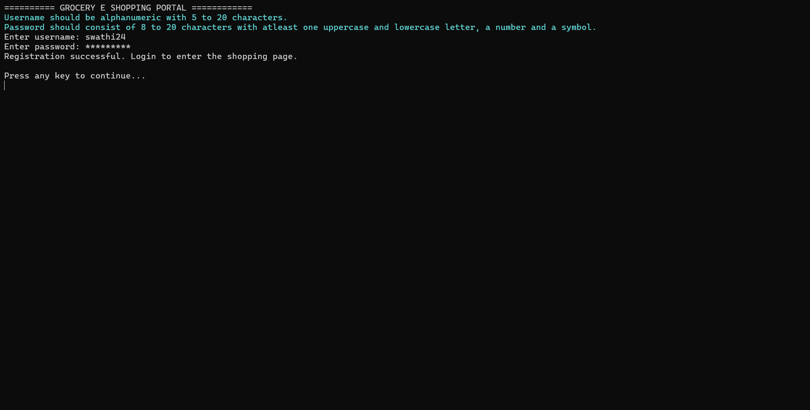
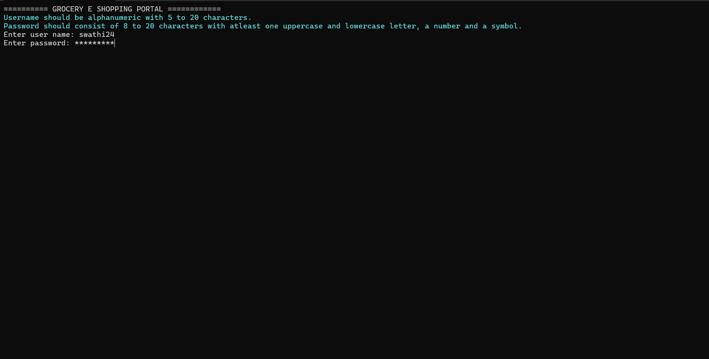
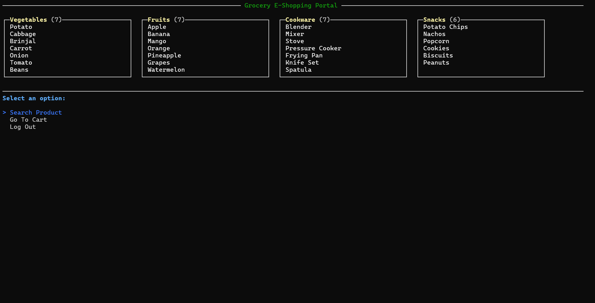
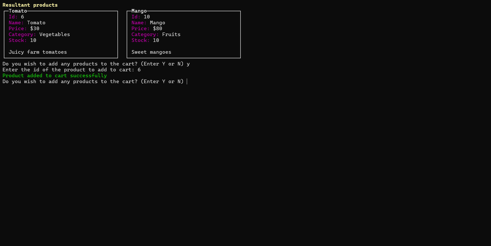
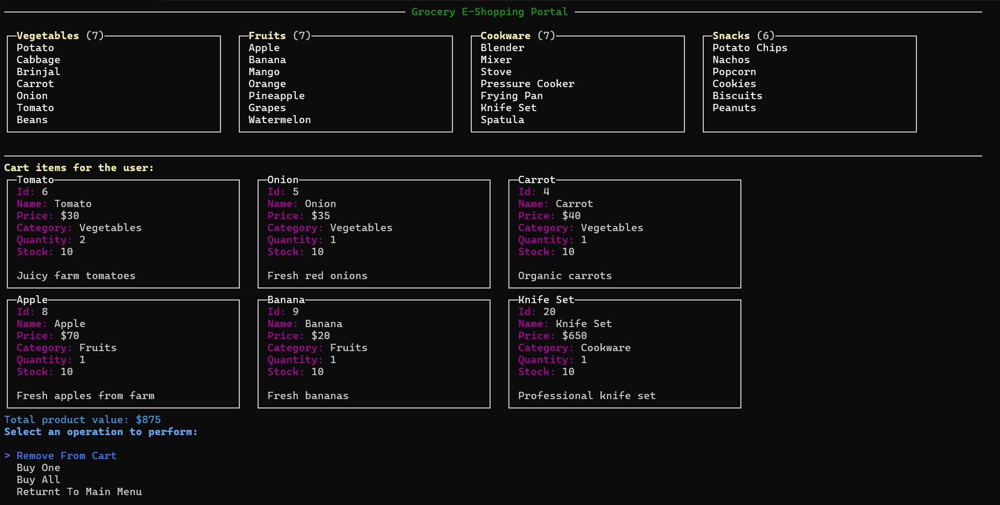
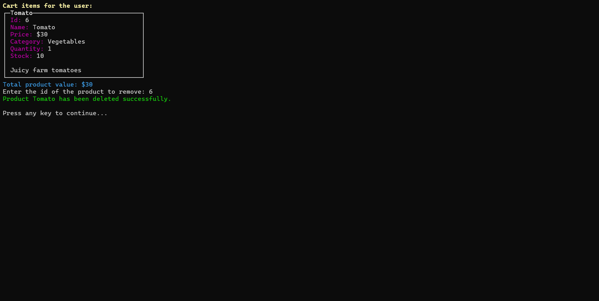
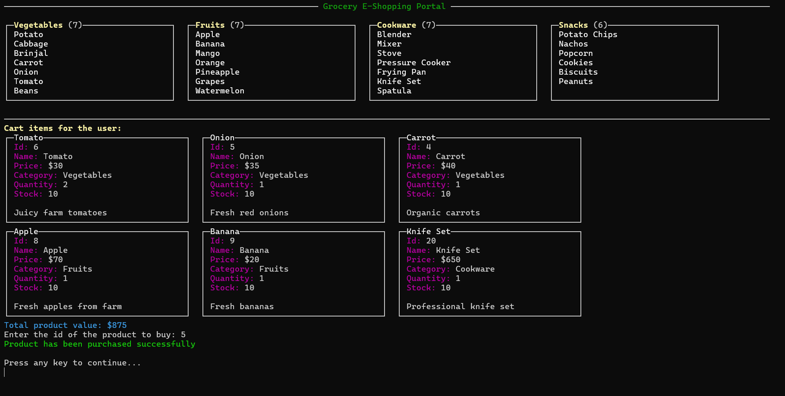
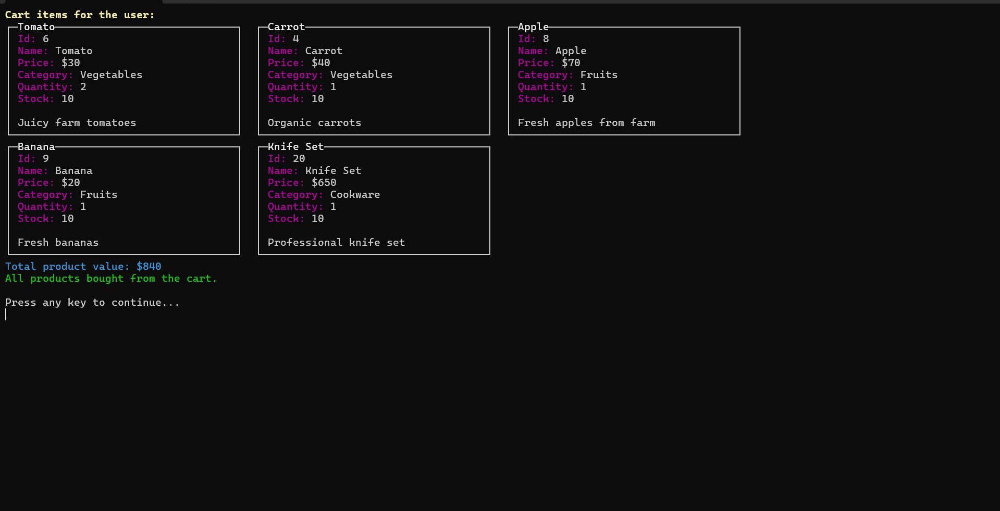

## Introduction
The **Grocery E Shopping Portal** is a console based shopping application that allows users to:
- Create an account
- Log in securely
- Browse products by category 
- Search for products
- Add products to a shopping cart
- Remove products from the cart
- Purchase individual products
- Purchase all products in the cart
- Log out and exit the application

# 1. Launching the application
When the application starts the following menu is displayed.

### Navigation Control
| Key | Action |
|-----|-----------|
|↑ | Move up |
|↓ | Move down |
| Enter | Select Option |

# 2. User Registration (Sign up)
Select **Signup** from the home screen.

### Username Requirements
- Must be alphanumeric.
- Length must be between 5 to 20 characters.

### Password Requirements
- Length must be between 8 to 20 characters
- Must contain:
	- At least one uppercase letter
	- At least one lowercase letter
	- At least one number
	- At least one symbol

## Registration Screen

Passwords are hidden using asterisks.

## User Login
Select **Login**.

After successful authentication, the user enters the shopping portal.

# 4. Shopping Dashboard
After login, all product categories are displayed.

The user can search a product, visit the cart page or log out from the shopping page.

# 5. Searching products

Enter a product name or keyword. The resultant product will be displayed to the screen.

# 6. Adding products to Cart
After the search results are displayed, enter Y or N to add any products to the cart.

# 7. Viewing the Cart
The application displays all the items currently added by the user.

Each cart item shows:
- Product ID
- Product Name
- Price
- Category
- Quantity
- Available Stock
- Description

- The application also calculates the total value of all items in the cart and displays it to the user.

# 8. Cart Operations
Inside the cart, the following options are available:
> Remove From Cart
  Buy one
  Buy All
  Return to Main Menu

# 9. Remove from cart

- Reduces the quantity of the selected product by one.
- Removes the product completely when the quantity reaches to zero.

# 10. Buy Single Product

For the selected product:
- One unit is purchased.
- Product stock decreases by one.
- Cart quantity decreases by one.
- Product remains in the cart if additional quantity exists.

# 11. Buy All Products

The application:
- Purchases all products currently in the cart.
- Updates product stick based on purchased quantity.
- Removes purchased items from the cart.

# 12. Return to Main Menu
- The application redirects the user to the shopping page.

# Features Summary

✅ User Registration

✅ User Login

✅ Password Masking

✅ Product Search

✅ Category-wise Product Display

✅ Add to Cart

✅ Quantity Management

✅ Cart Value Calculation

✅ Buy Single Product

✅ Buy All Products

✅ Stock Management

✅ Logout

✅ Exit Application